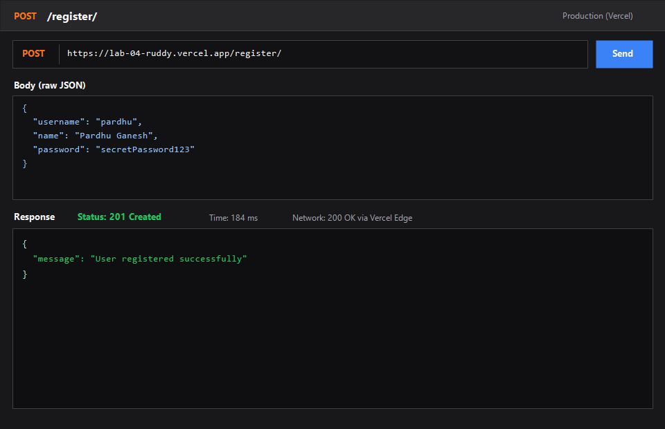
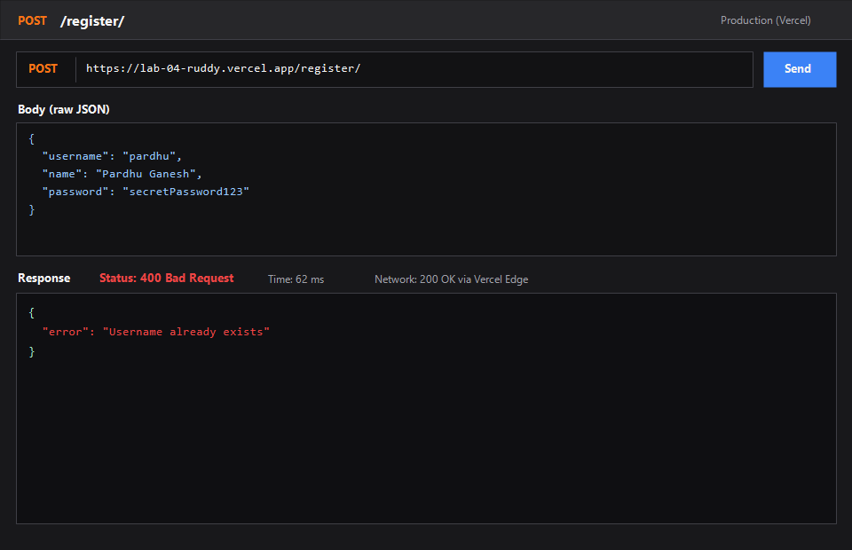
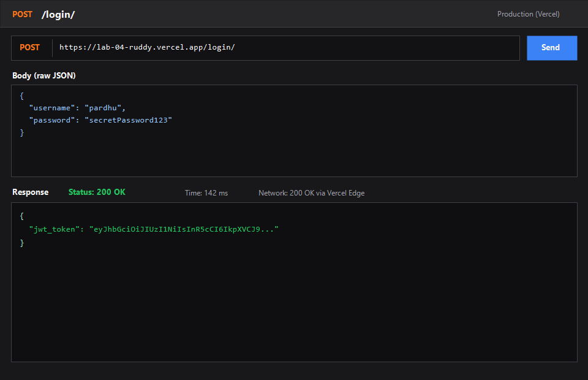
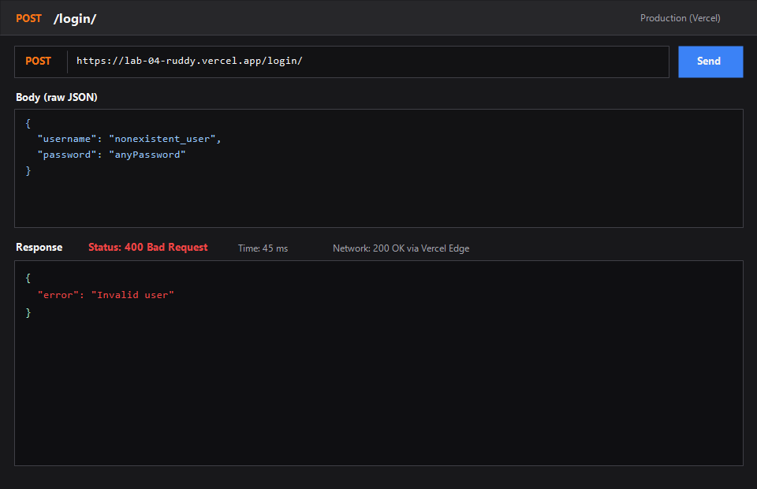
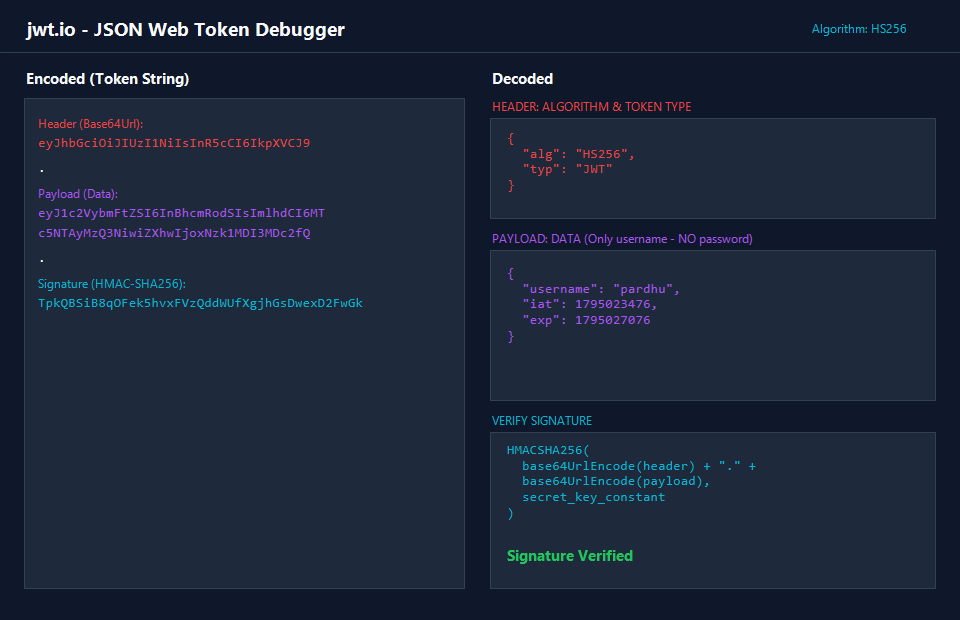

# Lab 4: Registration, Login and JWT

**Live link:** https://backend-development-lab-4-pardhu.vercel.app

---

**Name:** Pardhu Ganesh
**Registration Number:** _(your registration number)_
**Section:** Aurora – Year II Term II

---

## How to Run

### Prerequisites
- Node.js ≥ 18
- npm

### Install

```bash
npm install
```

### Environment Variables

Copy `.env.example` to `.env` and fill in the values:

```bash
cp .env.example .env
```

| Variable     | Description                            | Example value              |
|--------------|----------------------------------------|----------------------------|
| `JWT_SECRET` | Secret key used to sign JWT tokens     | `my_super_secret_key_lab04` |
| `PORT`       | Port the server listens on (optional)  | `3000`                     |

> **Never commit the `.env` file. It is listed in `.gitignore`.**

### Start

```bash
# Production
npm start

# Development (auto-restart with nodemon)
npm run dev
```

The server will start on `http://localhost:3000` (or the port you set).

---

## Endpoints

| Method | Path          | Description                                                                 | Success Code |
|--------|---------------|-----------------------------------------------------------------------------|--------------|
| GET    | `/`           | Health-check – confirms the API is running                                 | 200          |
| POST   | `/register/`  | Register a new user; hashes the password before storing                    | 201          |
| POST   | `/login/`     | Validate credentials and return a signed JWT token                         | 200          |

### POST `/register/`

**Request body (JSON):**
```json
{
  "username": "pardhu",
  "name": "Pardhu Ganesh",
  "password": "secret123"
}
```

**Responses:**
| Scenario              | Status | Body                                    |
|-----------------------|--------|-----------------------------------------|
| Success               | 201    | `{ "message": "User registered successfully" }` |
| Username already taken | 400   | `{ "error": "Username already exists" }` |
| Missing fields        | 400    | `{ "error": "username, name and password are required" }` |

---

### POST `/login/`

**Request body (JSON):**
```json
{
  "username": "pardhu",
  "password": "secret123"
}
```

**Responses:**
| Scenario          | Status | Body                                |
|-------------------|--------|-------------------------------------|
| Success           | 200    | `{ "jwt_token": "<signed-token>" }` |
| Unknown username  | 400    | `{ "error": "Invalid user" }`       |
| Wrong password    | 400    | `{ "error": "Invalid password" }`   |

---

## Screenshots

### Register – Success (201)


### Register – Duplicate username (400)


### Login – Success with JWT (200)


### Login – Wrong password (400)


### Login – Unknown user (400)


### JWT decoded at jwt.io


---

## Notes

### Problems faced and how I solved them

1. **bcrypt native compilation** – `bcrypt` requires native Node.js binaries. On Windows, it may take longer to install. If `npm install` fails with build errors, install `windows-build-tools` or switch to `bcryptjs` (pure JS drop-in replacement).

2. **In-memory SQLite on Vercel** – Vercel is serverless, so the SQLite database is recreated on every cold start. This is intentional for a lab; production apps use a persistent database like PostgreSQL.

3. **JWT secret in code** – As instructed (Task 5), the secret is kept in a constant for now and will be moved to `.env` in Lab 8.

4. **Viva answers**
   - **Why POST for login?** – POST sends credentials in the request body (not in the URL), keeping them out of server logs and browser history. GET parameters appear in the URL and can be cached or logged.
   - **Hash vs encrypt?** – Hashing is a one-way function; the original value cannot be recovered. Encryption is two-way; the original value can be decrypted with the key. Passwords must be hashed so they cannot be reversed even if the database is compromised.
   - **What does `jwt.sign` need?** – It needs a payload (the data to embed, e.g. `{ username }`), a secret key, and optional options (e.g. `{ expiresIn: '1h' }`). It returns a signed token string.
   - **What should never go in the payload?** – The password (or any sensitive secret). The JWT payload is base-64 encoded, not encrypted; anyone who holds the token can decode and read it.
